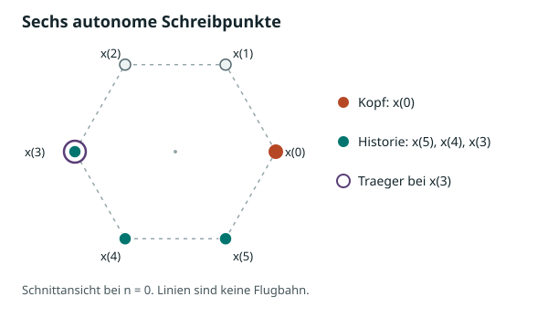

# Ein exaktes FIFO-Sechseck mit zwei Kraftprofilen

Stand: 2026-11-24. Konstruktiver Vergleich zum
[Zwei-Orte-Ausschluss fuer ein Kraftprofil](fifo_faithful_history_2026-11-24.md).
Dieselbe reversible Schreibkarte, derselbe freie Rotor und
drei bewegliche Speicherorte. Keine native Zieltrajektorie
und kein Parameterscan.

**Ergebnis.** Zwei eigenstaendige, konservative Lesekopplungen
tragen eine exakt wiederkehrende Sechs-Schritt-Bahn. Alle
Register enthalten an jedem Schnitt die tatsaechlichen
vergangenen Kopfpositionen. Der Rotor treibt keinen Write
mit externer Arbeit an. Die Bahn ist aber exakt vorbereitet
und abgestimmt; senkrecht zu ihrer Ebene ist sie linear
instabil. Es ist eine Existenzkonstruktion fuer eine
nichtkollineare FIFO-Schreibfolge, kein selbststabilisierter
Knoten und kein Teilchennachweis.

## 1. Zwei Kraefte statt einer

Kopf und Traeger haben Masse $m$, die drei Speicherorte
Masse $\mu$. Mit festem $\delta\in(0,1/4)$ verwende je
einen gleich starken quadratischen Beitrag um die Zentren
$M_\pm=\sum_j w^\pm_j y_j$, mit den beiden konvexen Profilen

$$
w^\pm=\left(\tfrac14\pm\delta,\tfrac12,\tfrac14\mp\delta\right).
$$

Der gemeinsame Potentialterm ist

$$
U=\frac{m\omega^2}{4}\sum_{\pm}
\left(|x-M_\pm|^2+|b-M_\pm|^2\right).
$$

Er ist translations- und rotationsinvariant. Neben dem
Relativoszillator $d=x-b$ mit Frequenz $\omega$ gibt es
zwei massenorthogonale Oszillatoren. Mit $c=(x+b)/2$
sind ihre Koordinaten
$c-(y_0+2y_1+y_2)/4$ und $y_0-y_2$.
Ihre quadrierten Frequenzen sind

$$
\frac{\Omega_s^2}{\omega^2}=1+\frac{3m}{4\mu},\qquad
\frac{\Omega_a^2}{\omega^2}=\frac{4m\delta^2}{\mu}.
$$

Der Rest besteht aus freien Normalmoden. Ein Schritt um
$60^\circ$ in der Relativbewegung braucht $T=\pi/(3\omega)$.
Waehlt man $\Omega_s=12\omega$ und $\Omega_a=6\omega$,
machen die anderen beiden Moden in derselben Zeit
zwei bzw. einen vollen Umlauf. Diese Vorgabe bestimmt

$$
\mu/m=3/572,\qquad \delta^2=27/572.
$$

Die Gewichte bleiben strikt positiv. Das ist eine
analytisch konstruierte Resonanz, keine Vorhersage der
Massen oder ein aus dem nativen Memory abgeleiteter Kernel.

## 2. Exakte Schreibfolge ohne Reset

Zur Notation repraesentiere die reale Bewegungsebene
durch komplexe Zahlen und setze $\lambda=e^{i\pi/3}$.
Am Eingang zum Schnitt seien $x=X\ne0$, $b=-X$ und
$y_j=\lambda^{-j-1}X$ fuer $j=0,1,2$. Da
$\lambda^{-3}=-1$, passt der Traeger genau zum alten
letzten Eintrag. Der Write speichert den Kopf exakt.

Seien $D=P_x-P_b$ und $Q=P_x+P_b$. Die vorbereiteten
Impulse sind

$$
D=2i m\omega X,\quad Q=\lambda^{-1}D,\quad
P_b=(1-\lambda)Q/2,\quad P_x=Q-P_b,\quad
P_{y_j}=\lambda^{-j-1}P_b .
$$

Insbesondere ist $P_{y_2}=-P_b$ und der Gesamtimpuls
null, da $\sum_{j=0}^2\lambda^{-j-1}=2/(\lambda-1)$.
Die Speicherimpulse liegen im reellen Profilraum
$P_{y_0}-P_{y_1}+P_{y_2}=0$:
$\lambda^{-1}-\lambda^{-2}+\lambda^{-3}=0$.
Zusammen mit $Q=-\sum_j P_{y_j}$ heisst das:
Im Schwerpunkt-Speicher-Teil gibt es keine Impulse
in den freien Moden und damit keine Drift dieser Moden.

Der kanonische Write laesst $D$ unveraendert und setzt
$Q^+=Q-2P_b=\lambda Q$; die Speicherimpulse sind jetzt
$\lambda P_{y_j}$. Der relative Kreisflug multipliziert
$d,D$ mit $\lambda$. Der Rest kehrt exakt zu seinen
Orten und Impulsen nach dem Write zurueck, weil beide
gekoppelten Moden ganze Perioden vollenden und der
freie Teil nicht driftet. Der ankommende Zustand
ist damit in **allen** Raumkoordinaten und Impulsen
um $\lambda$ gedreht. Die Geschichte ist treu:
$y_j$ ist am naechsten Schnitt weiterhin die korrekte
Probe des Kopfes aus dem passenden frueheren Schritt.

Da der interne Flug Energie erhaelt und die Drehung
die interne Energie nicht aendert, ist die Write-Arbeit
genau null. Der positive Anfangsimpuls
$\pi_s=M_sL/T$ des Rotors bleibt deshalb unveraendert.
So ergibt die autonom errechnete Flugzeit wirklich $T$:
Sie wurde nicht nach jedem Schritt neu gesetzt.
Nach sechs Schnitten kehrt der gesamte Zustand zurueck.
Die Konstruktion gilt fuer jeden endlichen Radius
$|X|>0$, aber die Anfangsimpulse und Resonanz
sind bewusst vorbereitet.

## 3. Kritischer Gegencheck: Querinstabilitaet

Eine senkrechte Stoerung hat am planaren Grundzustand
keine lineare Wirkung auf die Schnittarbeit: Die Energie
ist quadratisch und isotrop in den Raumkomponenten.
Die Rotorzeit aendert sich in dieser Richtung daher
erst in zweiter Ordnung. Die Querableitung des vollen
autonomen Returns ist die feste symplektische Matrix $J$
aus Write und Flug, in allen sechs Phasen dieselbe.
Die Auswertung eines solchen Rueckkehrblocks ist ein
methodischer Bezug zu
[Wulff und Roberts](https://doi.org/10.1137/S1111111101387760);
deren Resultate werden hier nicht als Stabilitaetsbeweis eingesetzt.

Fuer $m=\omega=1$ beschreibe $C$ den Orts-Write,
$G=C^{-T}$ seinen Impulsblock, $e=(1,0,0,0,-1)^T$,
$P=ee^T/2$, $U_1=I-P/2$ und $s=\sqrt3/2$.
Sei $R=\operatorname{diag}(1,572/3,572/3,572/3,1)$
die inverse Massenmatrix und $K$ die freie inverse Masse
nach Abzug der drei massenorthogonalen Oszillatormoden.
Mit $v=(1/2,-1/4,-1/2,-1/4,1/2)^T$,
$a=(0,1,0,-1,0)^T$ ist

$$
K=R-P-\frac{Rvv^TR}{v^TRv}-\frac{Raa^TR}{a^TRa},\qquad
J=\begin{pmatrix}
U_1 C & (sP+TK)G\\
-sPC & U_1 G
\end{pmatrix}.
$$

Direkte Multiplikation ergibt
$\operatorname{tr}[(U_1C)^2]=
\operatorname{tr}[(U_1G)^2]=9/16$,
$\operatorname{tr}(PGPC)=3/4$ und
$\operatorname{tr}(KGPC)=164879/5184$.
Damit bleibt

$$
\operatorname{tr}(J^2)
=-\frac{164879\,\pi}{5184\sqrt{3}} .
$$

Da $J$ zehn Eigenwerte mit Vielfachheiten hat,
ist $\rho(J)^2\ge|\operatorname{tr}(J^2)|/10$,
also $\rho(J)>2$. In mindestens drei Raumdimensionen
hat die volle Sechs-Schritt-Rueckkehr daher einen
wachsenden Faktor groesser als $2^6$. Die feste
numerische Gegenprobe zeigt fuer den staerksten
Querzweig einen nichtverschwindenden Kopierfehler
$b-y_2$. Die Instabilitaet wird nicht bloss aus
einem Abweichen des Rundungsfehlers im Langzeitlauf
abgelesen. Fuer strikt zweidimensionale Stoerungen
wird hier kein Stabilitaetsurteil behauptet.

## 4. Kontrollen und Reichweite

[Referenzcode](../../experiments/current/reference/fifo_carrier_clock_cycle.py)
und [feste Kontrollen](../../tests/test_fifo_two_center_cycle.py)
pruefen die beiden Frequenzen, die exakte Verschiebung
der Historie, sechs tatsaechlich aufeinanderfolgende
autonome Returns, jeden einzelnen Phasenuebergang bei
groesserem Radius, einen allgemeinen konservativen
Flug und die volle Querableitung samt Spuridentitaet.
Die mehrschrittige Kontrolle mit Fliesskommazahlen
nutzt einen kleineren Radius, damit numerisches
Stoerungswachstum nicht den Existenztest verdeckt.
Die Herleitung selbst hat keine Radiusgrenze.

Die Ein-Profil-Barriere ist konstruktiv ueberwunden.
Offen sind Stabilitaet durch einen anderen Ruecklauf,
Robustheit gegen Verstimmung und die Herleitung einer
solchen Kopplung aus dem Projektmodell. Aus der
diskreten Geometrie allein folgt noch kein Spin,
keine topologische Bindung und keine Wechselwirkung
zwischen selbststabilen Knoten.
